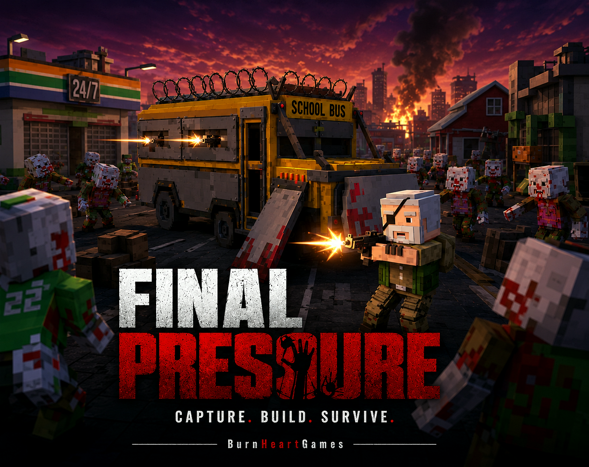
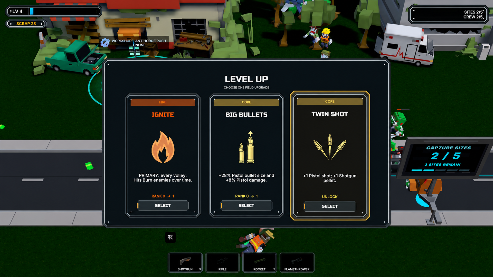
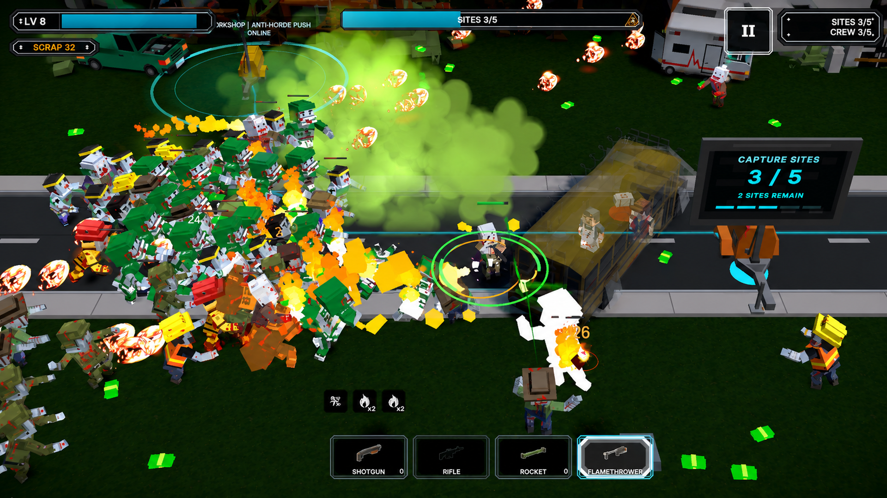
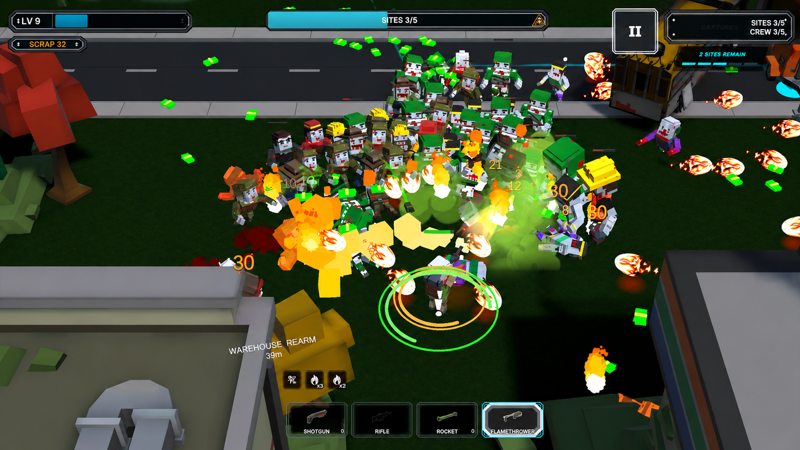
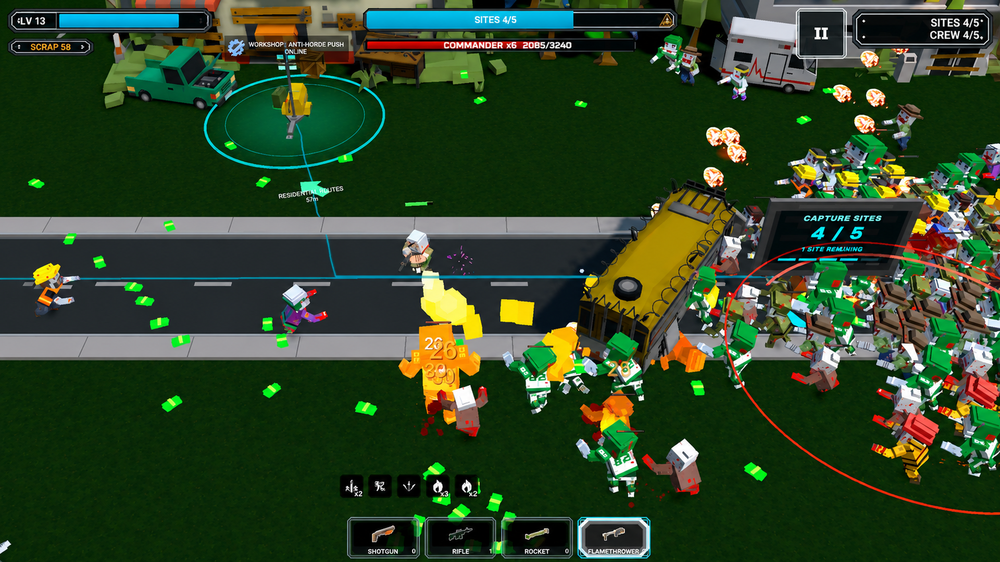
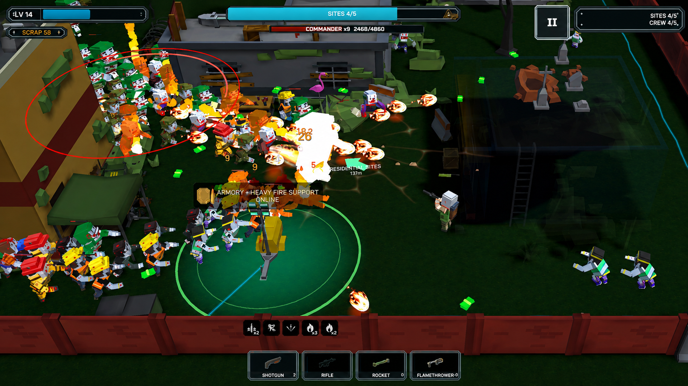
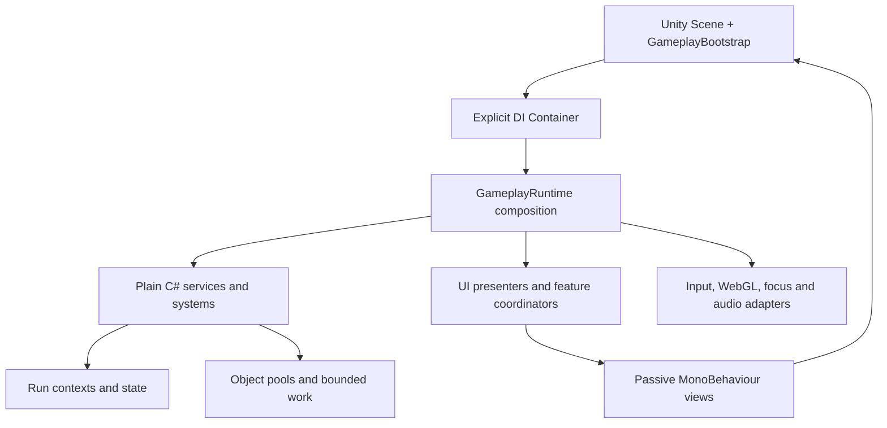

# FINAL PRESSURE

  

  
  
  
  
  

**FINAL PRESSURE** is a released top-down 3D zombie horde survival game built in Unity. The player fights through escalating pressure, collects cash-like XP pickups, chooses upgrades, secures optional specialist sites, and survives long enough to defeat the Commander.

**[Play FINAL PRESSURE on itch.io](https://burnheartgames.itch.io/final-pressure)** · **[Watch gameplay](https://www.youtube.com/shorts/n8YMwUCsyCQ)** · **[YouTube channel](https://www.youtube.com/@BurnheartGames)**

> Current public release: `v0.1.0-rc.9` · Unity WebGL · desktop and mobile browser support

## About the Game

The run starts with a permanent auto-firing Pistol and quickly grows into a layered survival loop. Defeated enemies drop resource pickups that fuel level-up choices. Workshop drops add weapons and support tools, while five optional specialist sites provide distinct tactical benefits around the Command Truck. The final sequence increases the pressure before the Commander enters the field; victory requires defeating the Commander while the player is still alive.

Weapons are intentionally low-friction. A collected Rifle equips automatically and returns to the Pistol when its ammunition is depleted. Shotgun, Rocket, and Flamethrower support fire trigger automatically when their target, ammunition, and cooldown conditions are satisfied.

## Play

- Desktop: move with `WASD` or the arrow keys. Pause or resume with `Escape` or `P`.
- Mobile: use landscape fullscreen mode and the virtual joystick.
- Weapons fire automatically. HUD weapon slots show ammunition, availability, and cooldown rather than acting as selection buttons.
- Menus and upgrade cards use mouse or touch input.

Browser and device performance varies. The WebGL presentation uses an adaptive pixel-density strategy to preserve UI clarity without ignoring mobile GPU cost.

## Screenshots

<table>
  <tr>
    <td width="50%"> Readable upgrade choices during a level-up pause.</td>
    <td width="50%"> Automatic support weapons create short tactical openings.</td>
  </tr>
  <tr>
    <td width="50%"> Dense combat built around pooling and bounded runtime work.</td>
    <td width="50%"> Optional specialist sites communicate range, state, and progress.</td>
  </tr>
  <tr>
    <td colspan="2"> The Commander battle closes the released run.</td>
  </tr>
</table>

## My Role

Solo developer responsible for:

- game design and scope control;
- C# gameplay architecture and Unity integration;
- combat, progression, capture sites, weapons, UI, audio lifecycle, and touch input;
- mobile/WebGL performance and presentation work;
- testing, release packaging, itch.io publishing, and product-page presentation.

## Project Background

FINAL PRESSURE was built as a focused release project: complete a coherent game loop, make it readable on desktop and mobile browsers, and carry it through public distribution. The project went through substantial scope reduction and technical cleanup so the strongest playable loop could be finished instead of expanding into unfinished systems.

This repository is a curated portfolio showcase. It is intentionally separate from the private Unity production repository and contains no full project, licensed source assets, music files, WebGL build, private release URLs, or Git history.

## Core Features

- Auto-fire combat with Pistol, Rifle, Shotgun, Rocket, and Flamethrower behaviors.
- XP/resource collection and upgrade-card progression.
- Five optional specialist sites: Medic, Engineer, Heavy, Sniper, and Quartermaster.
- Workshop drops, Command Truck support, escalating enemy pressure, and a final Commander encounter.
- Desktop and touch input with movement ownership preserved across gameplay popups.
- Responsive HUD, fullscreen WebGL shell, and adaptive device-pixel-ratio handling.
- Object pooling and bounded update budgets for dense combat on mobile-class hardware.
- Explicit focus, pause, resume, restart, and audio teardown handling.

## Technology

| Area | Implementation |
|---|---|
| Engine | Unity `6000.4.5f1` |
| Language | C# |
| Rendering | Universal Render Pipeline `17.4.0` |
| Input | Unity Input System `1.19.0` plus touch adapters |
| Camera | Cinemachine `3.1.5` |
| Navigation | AI Navigation `2.0.12` |
| UI | uGUI with MVP-style presenters/services and passive views |
| Platform | Unity WebGL, desktop and mobile browsers |
| Web shell | Project-owned responsive template with adaptive DPR and fullscreen handling |
| Performance | Pooling, bounded queries, controlled FX, and explicit lifecycle cleanup |

## Architecture Overview

| Layer | Responsibility | Typical form |
|---|---|---|
| Bootstrap | Scene composition and explicit dependency registration | Thin Unity entry point |
| Runtime | Run lifecycle and feature composition | Plain C# partial runtime |
| Domain systems | Combat, progression, capture sites, enemies, weapons | Services, systems, contexts |
| Presentation | HUD, FX, world markers, scene references | Passive `MonoBehaviour` views |
| Platform | WebGL focus, input, mobile/fullscreen behavior | Adapters and template integration |
| Configuration | Tunable balance and presentation data | `ScriptableObject` assets |

The project favors explicit dependencies, passive views, paired subscriptions, and deterministic teardown. See [Architecture](docs/ARCHITECTURE.md) for the design boundaries and tradeoffs.

## Engineering Notes

- [Architecture](docs/ARCHITECTURE.md)
- [WebGL and Mobile](docs/WEBGL_AND_MOBILE.md)
- [Release Pipeline](docs/RELEASE_PIPELINE.md)
- [Postmortem](docs/POSTMORTEM.md)
- [Selected C# Samples](samples/README.md)

## Selected Code Samples

| Sample | What it demonstrates |
|---|---|
| [`DIContainer.cs`](samples/selected-csharp/DIContainer.cs) | Small explicit dependency container with lifecycle management |
| [`TouchMovementInputReader.cs`](samples/selected-csharp/TouchMovementInputReader.cs) | Touch ownership and safe input preservation across popups |
| [`GameplayMusicService.cs`](samples/selected-csharp/GameplayMusicService.cs) | Music phase transitions, pause handling, and teardown |
| [`CapturePointUpdateExcerpt.cs`](samples/selected-csharp/CapturePointUpdateExcerpt.cs) | Capture eligibility, progress, interruption, and completion flow |
| [`RuntimeGameObjectPoolExcerpt.cs`](samples/selected-csharp/RuntimeGameObjectPoolExcerpt.cs) | Defensive spawn/release lifecycle for hot runtime objects |

These are selected original excerpts, not a standalone SDK or an open-source copy of the game. Surrounding Unity references, configuration, and production code are intentionally omitted.

## Release Snapshot

| Field | Value |
|---|---|
| Version | `v0.1.0-rc.9` |
| Status | Public / Released |
| Distribution | itch.io HTML5 / WebGL |
| Artifact | `FINAL_PRESSURE_0.1.0-rc.9_polish_itch.zip` |
| Artifact size | `63,959,451` bytes |
| SHA-256 | `2ec912d7b99fde29275b25812cffbe8740ba8eab43ee37a904d6f6b7d28c1042` |
| itch.io project / upload | `4839922` / `18604589` |

## Credits, Rights, and Disclosures

- Game development and original project code: Siarhei Ivanou / BurnHeartGames.
- Marketing cover created with generative AI tools and curated for this release.
- Original in-game music was created with Suno under a paid Pro plan. No audio files are included here.
- The production game contains legally acquired third-party Unity Asset Store content. This repository includes only rendered screenshots and cover material; source assets are not distributed.
- The project-owned WebGL shell was informed by Sean LeBlanc's Better Minimal WebGL Template. See [Third-Party Notice](THIRD_PARTY_NOTICE.md).

All repository contents are provided for portfolio viewing only. See [LICENSE.md](LICENSE.md).

## Links

- [Play on itch.io](https://burnheartgames.itch.io/final-pressure)
- [Gameplay video](https://www.youtube.com/shorts/n8YMwUCsyCQ)
- [BurnHeartGames on YouTube](https://www.youtube.com/@BurnheartGames)
- [BurnHeartGames on Instagram](https://www.instagram.com/burnheartgames)
