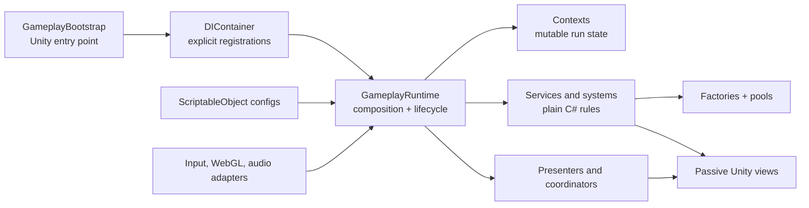
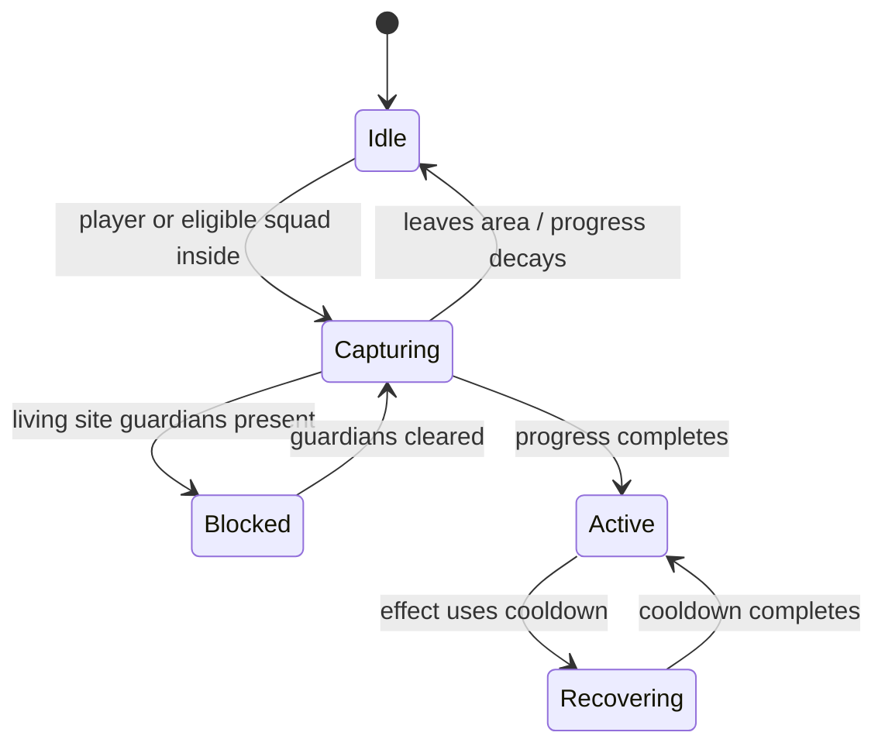

# Architecture

FINAL PRESSURE uses a pragmatic layered architecture designed for a solo-developed Unity game with a dense runtime, multiple input modes, and a WebGL release target. The central goal is to keep gameplay decisions testable and explicit while limiting `MonoBehaviour` classes to Unity-facing responsibilities.

## Runtime Shape

`GameplayBootstrap` collects scene references and establishes the composition root. A small custom container resolves explicit registrations and coordinates initialization/disposal. `GameplayRuntime` then composes the run features and owns their lifecycle; it is split by feature so the composition role does not become a single monolithic implementation file.

## Boundaries

| Boundary | Owns | Does not own |
|---|---|---|
| Bootstrap | Unity scene references, registration, start-up | Gameplay rules |
| Runtime composition | Feature construction order, run start/end, teardown | Per-frame visual implementation |
| Context | Mutable state shared by a feature | Scene discovery or rendering |
| Service/system | Gameplay decisions and state transitions | Hidden global access |
| Factory/pool | Creation, reuse, release | Run-state decisions |
| Presenter/coordinator | UI state mapping and player-facing flow | Low-level rendering |
| View | Serialized references, Unity callbacks, visual output | Game rules |
| Platform adapter | Browser, focus, fullscreen, or device-specific behavior | Core combat logic |

Dependencies are passed through constructors or explicit initialization. There are no gameplay singletons. Hot-loop systems avoid LINQ and unnecessary allocation, while subscriptions and unsubscriptions are paired explicitly.

## Feature Composition

The released run is composed from focused feature groups rather than one inheritance hierarchy:

- **Combat:** targeting, weapon timing, projectiles, damage, knockback, and hit presentation.
- **Enemies:** spawning, navigation budgets, state, death, and pooled reuse.
- **Progression:** XP/resource pickups, upgrade choices, and run-level modifiers.
- **Capture sites:** eligibility, local guardian pressure, capture progress, specialist effects, cooldown/recovery presentation, and rewards.
- **Presentation:** HUD presenters, world markers, FX, damage numbers, and passive scene views.
- **Lifecycle:** start, pause, resume, focus transitions, victory/defeat, restart, and disposal.

This is not a pure domain-driven architecture. Unity is intentionally present at the edges and in data types where that keeps the implementation direct, but orchestration and gameplay rules remain in plain C# wherever practical.

## Capture-Site Flow

Capture sites are a useful example of the separation between state, rules, and presentation.

The service evaluates the zone, guardians, player/squad presence, and progress. A context stores per-site runtime state. Views render the ground ring, label, progress, pulse, and outgoing effect without deciding whether a capture is legal. Completion callbacks apply only the specialist function that already belongs to that site.

## UI and Input

UI follows an MVP-style split:

- Views expose Unity references and forward events.
- Presenters/services convert runtime state into visible labels, fills, colors, and button availability.
- Gameplay input readers remain separate from popup selection.

On touch devices, the active movement pointer can remain owned by the virtual joystick while an upgrade or cache popup is displayed. A second pointer can select a card. Pause, menu, victory, and defeat flows perform a hard input reset. This distinction avoids both interrupted movement and stuck input.

## Data and Configuration

Tunable gameplay and presentation values use `ScriptableObject` configurations where appropriate. Runtime contexts hold transient run state. This makes the source of a value visible without turning configuration assets into active global services.

## Performance Boundaries

Dense horde combat is kept predictable through bounded work:

- enemies, projectiles, pickups, damage numbers, and hot FX are pooled;
- expensive navigation and spatial work use per-frame budgets;
- targeting uses distance-squared comparisons where possible;
- visual effects are short-lived and reuse simple materials/meshes;
- pooled instances are reset defensively before reuse and during release;
- browser pixel density is constrained by an adaptive pixel budget rather than a single low-resolution cap.

## Lifecycle Safety

Every run has an explicit beginning and end. Services that subscribe, schedule audio, or own pooled objects implement paired cleanup. Focus loss pauses the appropriate layers without creating duplicate scheduled music sources. Restart and terminal screens clear input ownership and release active runtime state before another run begins.

## Tradeoffs

- The runtime composition surface is broad because a complete run crosses many features. Splitting composition by feature keeps navigation manageable, but it remains an integration-heavy layer.
- Some Unity types cross into plain C# services to avoid unnecessary conversion objects in a small project.
- The custom DI container is deliberately limited. It provides explicit registration and lifecycle ordering, not reflection-heavy framework features.
- Selected production systems are larger than their ideal isolated form because the release pass prioritized stability and readable behavior over a late architectural rewrite.

These tradeoffs were accepted to finish and publish a stable browser build while preserving clear boundaries for the most change-sensitive gameplay and platform code.
