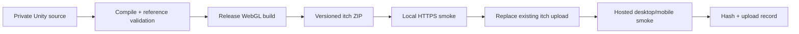

# Release Pipeline

FINAL PRESSURE is distributed as a Unity WebGL HTML5 game on itch.io. The pipeline is intentionally small and auditable: validate the project, produce one versioned artifact, smoke it over local HTTPS, replace the existing itch.io browser upload, and repeat the smoke on the hosted page.

## Release Flow

## 1. Source Validation

Before building:

- Unity compilation errors are zero;
- missing scripts and required serialized references are checked;
- intended scene state is saved in the Editor;
- `git diff --check` passes for source changes;
- movement, multi-touch popup interaction, pause/resume, restart, and audio focus cycles are exercised;
- capture-site readability, resource pickups, and weapon presentation are checked in Play Mode.

The private production repository remains the source of truth. This public showcase is never used to build the game.

## 2. WebGL Build and Packaging

The release build uses the project-owned responsive WebGL template and the current release version. The itch archive contains the build entry point and Unity-generated output at its root so itch.io can identify it as an HTML playable build.

After packaging, record:

- semantic/display version;
- artifact filename and byte size;
- SHA-256 digest;
- build date and validation result.

The WebGL ZIP is a distribution artifact and is not committed to either the private source repository or this showcase.

## 3. Local HTTPS Smoke

The packaged output is served over local HTTPS before upload. This catches path, compression/header, browser security, loader, and fullscreen behavior that cannot be established by Unity compilation alone.

Minimum flow:

1. load the page from a cold browser session;
2. confirm the release version and main menu;
3. start a run and enter gameplay;
4. open and close an upgrade popup;
5. pause and resume;
6. enter and exit fullscreen;
7. check landscape/touch layout and browser console output.

## 4. itch.io Replacement Upload

The release replaces the active playable upload on the existing game page. It does not create a new game slug or public URL. The previous working artifact is retained as an inactive rollback when the platform interface permits it.

Page state is checked independently of the binary:

- kind: HTML;
- release status and visibility;
- mobile-friendly landscape presentation;
- click-to-launch fullscreen behavior;
- cover, screenshots, description, controls, credits, and AI disclosure.

No private draft secret or account credential belongs in the release record.

## 5. Hosted Smoke and Rollback

The public HTTPS page is checked in a normal session and a signed-out/private session. The same main-menu-to-gameplay smoke is repeated, and network/console failures are reviewed. A broken host upload is rolled back to the retained previous artifact rather than publishing a new page.

## RC9 Release Record

| Field | Value |
|---|---|
| Version | `v0.1.0-rc.9` |
| Release state | Public / Released |
| Artifact | `FINAL_PRESSURE_0.1.0-rc.9_polish_itch.zip` |
| Size | `63,959,451` bytes |
| SHA-256 | `2ec912d7b99fde29275b25812cffbe8740ba8eab43ee37a904d6f6b7d28c1042` |
| itch.io project ID | `4839922` |
| itch.io upload ID | `18604589` |
| Public page | <https://burnheartgames.itch.io/final-pressure> |

This record identifies the released artifact without publishing the artifact itself or exposing internal source-control history.
