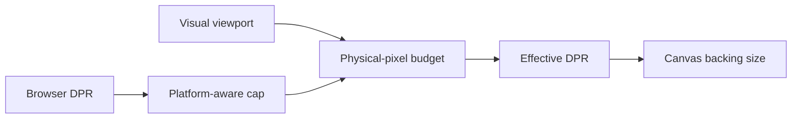

# WebGL and Mobile

The public build targets desktop and mobile browsers from one Unity WebGL artifact. The release work focused on three practical risks: blurred UI caused by overly low render density, browser fullscreen/layout inconsistencies, and touch state becoming stuck or interrupted by modal gameplay UI.

## Project-Owned WebGL Shell

The production project uses a project-owned `FinalPressureRetina` WebGL template informed by Sean LeBlanc's Better Minimal WebGL Template. The showcase does not redistribute template source; this document describes the responsibilities of the integration.

The shell coordinates:

- responsive canvas sizing against the actual browser viewport;
- `visualViewport` changes on mobile browsers;
- fullscreen entry, exit, and resize events;
- device-pixel-ratio selection and a physical-pixel budget;
- focus restoration after launch and fullscreen transitions;
- touch-safe page behavior, including disabled gesture scrolling over the game surface;
- a launch surface suitable for itch.io's click-to-fullscreen flow.

## Adaptive Pixel Density

A single hard DPR value was not suitable for both desktop displays and phones. The released strategy starts from the browser's reported device pixel ratio, applies platform-aware limits, and then reduces the effective ratio only when the resulting framebuffer would exceed a defined pixel budget.

This preserves sharper HUD text on high-density mobile screens while avoiding an unbounded GPU load at large fullscreen resolutions. The raw and effective values are logged in development diagnostics so scaling decisions can be checked on real devices.

## Viewport and Fullscreen

Mobile browser chrome changes the usable area during rotation, scroll suppression, and fullscreen entry. Canvas size is therefore derived from the current visual viewport rather than assuming a static CSS window size. Resize and fullscreen events converge on the same sizing path so returning from fullscreen does not leave a stretched or low-resolution surface.

The itch.io page launches the HTML5 build in landscape fullscreen mode. The game still supports a responsive embedded surface, but landscape fullscreen is the intended mobile presentation.

## Touch Ownership Across Popups

Level-up and cache choices can appear while the player is holding movement. The touch input reader tracks an active movement pointer separately from popup interaction:

1. the joystick keeps ownership of its active pointer when an eligible gameplay popup opens;
2. a second pointer can select a card or menu choice;
3. releasing the movement pointer inside the popup is still observed and clears movement;
4. closing the popup refreshes joystick state without synthesizing a stuck direction;
5. pause, menu, victory, and defeat always perform a hard reset.

This behavior is represented in [`TouchMovementInputReader.cs`](../samples/selected-csharp/TouchMovementInputReader.cs).

## Performance Strategy

Mobile clarity was improved without treating visual quality as free:

- adaptive DPR is bounded by framebuffer cost;
- enemies, projectiles, resource pickups, damage numbers, and hot FX are pooled;
- navigation and other costly queries use per-frame budgets;
- capture markers and resource visuals use inexpensive meshes/materials;
- transient effects remain short and avoid high-cost particle layering;
- screen-space UI prioritizes readable contrast and category accents over heavy effects.

## Focus and Audio Lifecycle

Browser focus changes can occur during fullscreen prompts, tab switches, or mobile interruptions. The game keeps focus handling explicit so music and stingers are paused/resumed rather than rescheduled on top of existing sources. Pitch remains at normal speed, and restart/end/dispose paths stop owned playback exactly once.

## Release Validation

The RC9 host smoke covered:

- HTTPS page load and Unity loader completion;
- main menu, start, gameplay, pause, and resume;
- desktop fullscreen entry/exit;
- responsive landscape layout and touch UI presence;
- correct version presentation and browser runtime without observed console errors;
- sharper HUD/card/menu text under the adaptive DPR strategy.

Physical-device performance depends on browser, thermal state, screen size, and GPU. A cold smoke on the target iPhone/Android devices remains the final check for any future artifact even when desktop emulation passes.
